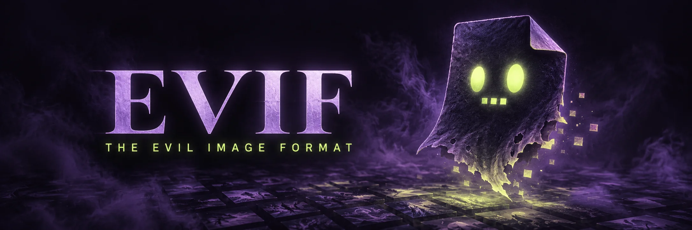

# EVIF, the evil image format [](https://github.com/imazen/evif/actions/workflows/ci.yml) [](https://crates.io/crates/evif) [](https://lib.rs/crates/evif) [](https://docs.rs/evif) [](#license)

<p align="center"></p>

**AI codecs and AI codec optimizers will find novel blind spots in image quality
metrics. Let's find and fix them first.**

EVIF probes encoder settings and distortions for disagreements between IQA metrics,
then packages the findings so people and new metrics can examine the same samples.
The goal is to expose weaknesses before optimization learns to exploit them.
Disagreement identifies a case to investigate; human review determines which metric
needs fixing.

An `.evif` file can store **a lossless PNG or IMIJ rendition of the distorted
encode's decoded pixels**, together with its recipe and scores. “Lossless” describes
how those already-distorted pixels are stored; it does not undo the distortion.
The original JPEG, AV1 or JPEG XL bytes are optional: keep them for decoder replay,
or omit them while retaining their encoded size and checksum. You do not need both
PNG and IMIJ copies of the same samples.

The new [major-1 wire format](SPEC.md) stores reference and candidate with identical
SDR/HDR still/video asset records, optional original bytes, and appendable scoring
JSON. `evif::wire` reads/writes it without buffering whole payloads. The probe
commands below still use the [legacy still format](docs/legacy-wire-0.md);
the new container does not itself run video metrics or render an HDR display.
Use [`evif wire pack`, `inspect`, and `append`](docs/wire-tools.md) for major-1 files.
Decoded samples use canonical XXH3-128 with an optional SHA-256 check; adding that
check does not change media identity. The writer's frame-hashing helper emits both
by default, with an XXH3-only path available. Hash records carry explicit
algorithm IDs and variable-length digests so future hashes fit the same grammar.
The Rust implementation uses our [zenhash](https://github.com/imazen/zenhash)
crate; see the [hash selection evidence](benchmarks/hash-portability-2026-10-25.md).

## Why search beyond fixed datasets

Fixed datasets test a metric on a known set of distortions. AI codecs and codec
optimizers search for new ways to improve their objective, including changes a
metric rewards more than a viewer would. EVIF searches across encoder controls and
synthetic distortions, retaining the recipe, exact decoded pixels and measured
encoded cost when a real bitstream exists. Synthetic costs are labeled separately.

A finding can be rescored with an unseen metric without repeating the original
search. Keep common failure modes near the front of the search and retain a long
tail of unusual but relevant distortions: tomorrow's optimizer may find them.

## How the probe works

For each reference image and one *stress family* (a codec with exposed encoder controls):

1. **Honest curve.** The family's default encoder is swept over quality to give a
   rate-distortion curve for every score key.
2. **Samples.** Parameter vectors are drawn at random: per-component, per-band
   quantization multipliers, zero-bias, chroma subsampling, adaptive quantization,
   deringing, trellis. Each is encoded, decoded by our decoder and scored by every
   judge.
3. **Equivalent bitrate.** Each key's score is read back through the honest curve
   into the bits per pixel an honest encode would need to score the same. The gain
   on a key is `log2(equivalent bpp / actual bpp)`: `+1` means the metric rates the
   encode like an honest file twice its size, `-1` like one half its size. Outside
   the swept range the equivalent clamps to the curve's ends, so a wrecked encode
   reads the same in every metric instead of being amplified by the metric with the
   narrowest scale.
4. **Disagreement.** The target metric's gain minus the mean of the others', in the
   same log2-bytes unit. The most disagreeing samples are written as `.evif` files,
   and every sample goes into a TSV ledger.

Disagreement is not ground truth: it says the metrics differ, not which one is wrong.
The written files are the pairs worth showing to people. Random search is a floor; a
proper optimizer over the same families comes next.

## Quick start

```sh
cargo build --release
target/release/evif list
target/release/evif probe --family zenjpeg-expert --target ssim2 \
    --out out/ssim2 --samples 256 --keep 8 corpus/*.png
target/release/evif inspect out/ssim2/<image>/zenjpeg-expert-017.evif
target/release/evif verify  out/ssim2/*/*.evif        # SEAL, PNG, pixel digest
target/release/evif extract out/ssim2/<image>/zenjpeg-expert-017.evif unpacked/
# Honest curve for an external scorer: decoded PNGs and render.tsv with bytes and bpp.
target/release/evif render --family zenjpeg-expert --out out/honest \
    --qualities 10,20,30,40,50,60,70,80,90 corpus/*.png
```

`inspect` prints what the file says about itself (a real file from a 24-sample run):

```
  1356x1132 Rgb U8
  bitstream: jpeg 29494 bytes
  interior bpp: 0.1537
  recipe: zenjpeg-color via zenjpeg 0.9.0 (a2a128ab)
  target: ssim2
  params: {"color":{"path":"ycbcr","subsampling":"s422"},"quality":36.77,
           "tables":{"family":"jpegli_shared","chroma_scales":[0.113,2.180]}, ...}
  zensim                    65.5594  (Higher, zensim@2b840717)
  ssim2                     62.1959  (Higher, fast-ssim2@54fabca9)
  butteraugli               18.2428  (Lower, butteraugli@02b570b4)
  butteraugli/3-norm         4.8084  (Lower, butteraugli@02b570b4)
  disagreement: 0.0797
  gain_vs_baseline: {"ssim2":-0.897,"zensim":-0.751,"butteraugli":-1.090, ...}
```

`extract` writes the retained candidate bytes, the stored PNG/IMIJ rendition of the distorted
candidate, and scores as JSON. Colliding codec/rendition extensions use a separate
`bitstreams/` directory. `--format native` extracts only the original candidate;
it fails if those bytes were omitted. EVIF-specific candidate streams use the
`.evifbits` extension to distinguish them from complete `.evif` containers.

## What is in the coffin

| chunk | holds |
|---|---|
| `HEAD` | dimensions, channel layout, sample type |
| `BITS` | optional candidate bytes: an external codec or EVIF-specific compression |
| `BINF` | recorded candidate codec, encoded size and checksum when bytes are omitted |
| `PNGF` **or** `IMIJ` | one lossless rendition of the distorted candidate: the exact pixels scored |
| `DIGS` | digests of the scored and source rasters |
| `clam` | explicitly synthetic claimed cost, when no encoded cost exists |
| `srce` `knob` `scor` | source, recipe and versioned scores |
| `SEAL` | checksum of the preceding file bytes |

PNG and IMIJ are alternatives; a file stores exactly one. Viewers show
that frozen candidate rendition because candidate decoders can differ in IDCT, chroma
upsampling or film grain. EVIF-specific compression goes in `BITS`, not in the
rendition. Legacy `PIXL` files remain readable. See [SPEC.md](SPEC.md).

### Storage and output choices

```sh
# One PNG rendition per candidate, without a second file of original codec bytes.
evif render --family zenjpeg-expert --qualities 20,60,90 --out out/png \
    --format png --omit-bits input.png
# Complete containers with PNGF candidate renditions and recorded codec costs.
evif render --family zenjpeg-expert --qualities 20,60,90 --out out/evif \
    --format evif --rendition png --omit-bits input.png
# The IMIJ-enabled companion stores the same distorted candidate pixels in IMIJ.
evif-private render --family zenjpeg-expert --qualities 20,60,90 --out out/imij \
    --format evif --rendition imij --omit-bits input.png
# Remove BITS from an existing file while preserving recipe, scores and provenance.
evif repack input.evif compact.evif --omit-bits
# Export only the retained original codec file.
evif extract input.evif out/native --format native
```

`render --format` accepts `png`, `imij`, `native`, or `evif`. `probe` and EVIF
rendering accept `--rendition png|imij` and `--omit-bits`. The public binary
provides PNG; a companion registers the IMIJ encoder/decoder through
`Registry::add_rendition_codec`. The container library can preserve and extract
IMIJ bytes without that plugin. Native output needs actual candidate bytes.

Existing defaults retain candidate bytes and use PNG candidate renditions.
`render.tsv` keeps its original first six columns and appends output format/path,
candidate codec/checksum, and retained bitstream path. An empty `png` column
means the selected output is not PNG. Candidate bpp counts the candidate codec,
never PNG/IMIJ storage or container overhead. `inspect` distinguishes embedded,
recorded, synthetic claimed, and unknown costs. Recorded checksums cannot prove
that an omitted bitstream can still be reproduced.

For Rust callers migrating from draft 0.0, `Evif.png` becomes
`Evif.rendition.data`; check `Evif.rendition.format` before decoding it.
`Evif::new` still accepts PNG bytes. Handle `Bpp::Recorded` when matching costs.

## HDR and video design

The current CLI evaluates RGB8 still images. The [HDR and sequence proposal](docs/hdr-video-evaluations.md)
separates lossless rendition storage, exact timing, viewing conditions and metric
execution. It includes executable contract and carrier checks; end-to-end HDR/video
support is not yet implemented.

## Families and judges

| family | what it varies |
|---|---|
| `zenjpeg-expert` | zenjpeg's `ExpertConfig`: 3×4 quant multipliers (component × DC/low/mid/high band), zero-bias, 4:4:4/4:2:2/4:4:0/4:2:0, AQ, deringing, trellis |
| `zenjpeg-color` | zenjpeg's color pipeline: YCbCr / XYB / RGB passthrough, jpegli chroma distance scales or mozjpeg chroma quality, gamma-aware chroma downsampling, deringing, AQ, auto-optimize |
| `zenpng-palette` | lossy PNG through zenpng + zenquant: palette size 2–256, quality preset, six dither modes and strength, Viterbi run weight |
| `zenav1-svt` (opt-in) | AV1 chroma quantization, QM, variance boost, sharpness, tune, transform limits and screen-content controls |
| `zenjxl` (opt-in) | JPEG XL quantization, chroma prediction, filtering, resampling, noise and transform controls |
| `corruption` | the structural defects of [corruption-corpus](https://github.com/imazen/codec-corpus): channel swaps, dropped blocks, off-by-one edges, wrong-phase chroma, real decoder bugs; pixels only, no bitstream |

| judge | keys |
|---|---|
| zensim | `zensim` (current codec-target profile) |
| fast-ssim2 | `ssim2` |
| butteraugli | `butteraugli` (max norm), `butteraugli/3-norm` |

Judges are pinned to specific revisions ([`evif-probe/src/pins.rs`](evif-probe/src/pins.rs)),
and every score row names the implementation that produced it.

Families and judges are plug-ins: `evif_probe::registry::Registry` holds the built-in
set, and a companion binary can add its own and reuse the CLI (`evif_probe::cli::main`).
That is how families and judges built on unpublished code join the same runs.

Build with `--features possession` for both new codec families, or select
`possession-svt` / `possession-jxl`. See [controls, replay and limits](docs/possession.md).

Coming: zenwebp and additional zenavif backends; a post-filter family with no rate
constraint (sharpening, grain, hue, sub-pixel shift); a human-judgment loop.

## Crates

- **`evif`**: the container. `no_std` + `alloc`, `#![forbid(unsafe_code)]`, reads and
  writes files and computes digests; decodes no image codec. MIT OR Apache-2.0.
- **`evif-probe`**: families, judges, the search and the `evif` CLI. Links the zen
  codecs and metrics at pinned revisions. AGPL-3.0 OR commercial, not published.

## License

`evif` is dual-licensed under MIT and Apache-2.0. `evif-probe` is AGPL-3.0-only or
the Imazen commercial license (see `evif-probe/LICENSE-*`).
