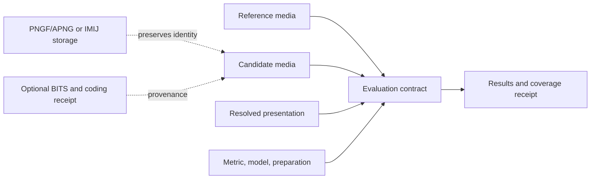

# HDR, sequences, and reproducible evaluations

Design proposal, 2026-10-25. **This is not implemented EVIF HDR/video support.**
[The current format](../SPEC.md) remains one sRGB still; the probe and its
rendition plugin still take RGB8. The executable checks below test the proposed
semantics and the existing carriers, not a new container reader or metric runner.

The [CVVDP/HDR-VDP source audit](vdp-input-audit.md) identifies concrete adapter
gaps and the additional photometry, spectral-emission, observer and task bindings
required before this proposal can claim sufficient inputs for those metrics.

The [resolved-rendition profile](resolved-renditions.md) specifies the initial
SDR/HDR video storage boundary: one complete signal per rendition, with no
mandatory gain map or duplicate SDR/HDR copy. It includes executable descriptor
and segment-plan checks, separate from metric configuration.

The unit of evidence is **an evaluation of identified media under a recorded
presentation and metric contract**. A codec file, a decoded raster, a display
simulation, and a score are different objects. Keeping their identities separate
allows compact storage without losing what was measured.

## Decisions

1. Keep one authoritative reference decode per asset. It may be a still or a
   timed sequence, encoded with PNG/APNG or lossless IMI. Candidate coding,
   including EVIF-specific compression, stays in optional BITS. A reference
   decode means the frozen decoder output; the pristine comparison source is a
   separate asset, not another encoding of the candidate.
2. Use exact rational presentation times. Keep native timing even when a metric
   requires a constant-rate derivative. Frame index, milliseconds, and fps alone
   are not interchangeable descriptions of a sequence.
3. Separate content colorimetry, intended presentation, and the metric's effective
   configuration. A profile name is a label; reproducibility requires its resolved
   values, model data, and implementation identity.
4. Support native sequence metrics, stateful per-frame metrics, and still metrics
   with explicit aggregation. Do not manufacture per-frame scores from a pooled
   metric, or call a mean of still scores a native video metric.
5. Identify evaluations with their complete contracts. Short metric labels remain
   display text, never persistent cache keys or unique result identifiers.
6. Make unsupported inputs, partial coverage, and undefined scores explicit.
   Unknown conditions do not default to sRGB, 100 nits, 60 ppd, or 30 fps.
7. Reuse zenpixels, zencodec, and zenmetrics-abstractions. EVIF owns evidence and
   provenance; it should not grow a parallel pixel library, media decoder, or
   metric trait hierarchy.

## 1. Media, representations, and dependencies

An asset descriptor records geometry, sample representation, color authority,
alpha, and its ordered presentation timeline. The asset identity is independent
of whether its samples are stored in APNG, IMI, or an external immutable resource.
Repacking and dropping BITS must leave that identity unchanged.

A storage descriptor identifies its carrier, codec revision/profile, encoded
object hashes, and any independently decodable segments. A decoder receipt
records the decoder revision and options that originally produced the frozen
samples: chroma reconstruction, film grain, orientation, and color conversion
can matter. Replaying the candidate decoder is a separate verification operation
from reproducing scores on the stored reference decode.

Each evaluated reference asset must be either embedded or resolvable by content
identity. A URL alone is insufficient. If the original source or a required model
is unavailable, mark the evaluation as not reproducible from available resources;
do not substitute a similarly named file. A collection may share one source across
many candidates without copying it into every record.

There is one authoritative rendition **per asset**, not one mandatory physical
copy for every evaluation. Derived metric inputs normally consist of a transform
recipe and resulting digest. Store them only when reuse cost, nondeterminism, or
an unavailable transform justifies a materialized derivative. Optional SDR previews
have their own role, transform provenance, and digest. They cannot satisfy an HDR
reference dependency. Gain-map base/map components are dependencies of a rendering
recipe, not duplicate versions of one raster.

For long clips, one logical rendition may consist of bounded, indexed segments.
The segment table maps logical frame ordinals to payloads and decode dependencies;
extra codec keyframes do not create additional presentation frames. Each segment
uses the declared carrier and reconstructs the same canonical samples and timing.
An archive of IMI files is not itself a playback timeline; the timeline remains
explicit.

## 2. Color and sample contract

The descriptor must distinguish:

- Stored sample type and significant bits: initially u8, u16, f16, f32; integer
  code alignment and endianness; channel/plane layout, dimensions, and subsampling.
- Primaries and white point, transfer function, matrix coefficients, signal range,
  chroma siting, and the authoritative ICC/CICP/custom definition. Preserve original
  metadata, but resolve precedence once and record the rule. Do not blend conflicting
  declarations or treat unknown color as sRGB.
- Signal domain: encoded code values, relative linear scene light, relative linear
  display light, or absolute display light. Record the scale/units and any exposure
  or diffuse-white mapping. A float buffer is not automatically absolute luminance.
- Alpha presence, straight/premultiplied interpretation, and the domain in which
  premultiplication occurred. Metric preparation records the background, compositing
  domain, and operation order when alpha is flattened.

PQ and HLG are not two labels for the same signal. HLG rendering needs a declared
system/display treatment. Mastering metadata describes content creation; it is
not the actual viewing display. Tone mapping, gamut mapping, clipping, range
conversion and quantization are explicit preparation steps with implementation,
parameters, ordering, and output digests. Their values cannot be inferred from a
codec extension.

Timed rendering metadata belongs to an identified track with exact support
intervals and a pinned interpretation. Dynamic tone-mapping metadata, gain-map
parameters, or changing exposure can change presentation while raster samples
stay identical. Retain their dependencies and include the selected rendering
recipe in evaluation identity. Preserve unknown metadata for transport, but refuse
a claim to have reproduced its intended rendering without a supported interpreter.
Source metadata must not silently override the experiment's prescribed display.

Use the carrier only when it can preserve the contract exactly. PNG/APNG supports
integer samples and PNG color metadata, including CICP HDR signaling. It does not
serve as an exact floating-point carrier. Use lossless IMI for admitted float
representations. PNG palette/gray/downcast optimizations may be used only if decode
expansion restores the declared channels and samples exactly. Transparent RGB is
part of the frozen sample identity, even if a particular display would hide it.
[PNG color signaling and APNG](https://www.w3.org/TR/png-3/).

Keep native planar YCbCr as a distinct asset representation when code-domain
metrics require it. An RGB round trip is not evidence that the original chroma
planes survived. Initial RGB-only storage implementations must refuse unsupported
native planar requests or declare the RGB-to-YCbCr derivative; they must not call
it native. A future planar carrier profile needs plane descriptors and exact
sample gates before admission.

## 3. Sample and presentation identity

Separate three hashes:

| Identity | Includes | Excludes |
|---|---|---|
| Encoded object | Exact stored bytes | Interpretation |
| Media asset | Sample descriptor, per-frame samples, color interpretation, timeline and source loop semantics | Carrier compression, file path |
| Evaluation | Input asset identities, presentation, transforms, alignment, metric/model/configuration, output definition | Measured score, wall time, storage locations |

Canonical sample hashing traverses rows without padding, with explicit plane order
and little-endian multibyte values. Include logical dimensions and descriptors in
the domain-separated hash. Keep IEEE bit patterns, including signed zero and NaN
payloads, for exact storage identity. Metric admission is a separate check: a metric
may reject nonfinite samples; the runner must not quietly replace them with zero.
Color changes, frame permutation, timing changes, and a changed alpha convention
change the asset identity even if the underlying sample bytes are identical.

Use full SHA-256 identities for new cross-file dependencies. Existing XXH3 DIGS and
SEAL remain legacy integrity checks; neither is authentication. Store the original
legacy digests during migration. A legacy sample digest cannot be promoted to an
HDR/sequence identity without reading the samples and resolving their description.

The prototype uses a restricted [JCS](https://www.rfc-editor.org/rfc/rfc8785)
descriptor: ASCII member names, safe JSON integers, canonical decimal strings for
physical quantities, and reduced rational pairs. It rejects JSON float/NaN and
lone Unicode surrogates. Production needs documented encoding of u64 values beyond
JSON's exact-integer range and published cross-language hash vectors. This subset
is not a claim that ordinary sorted JSON implements unrestricted JCS.

## 4. Timing, composition, and alignment

Store PTS and duration as reduced rationals, with an explicit timeline origin and
half-open presentation intervals. Use a finite evaluation interval, even for an
infinitely looping animation. Preserve source play count separately from the
experiment's iteration count and startup/warm-up policy. A still has no invented
frame rate; presenting it for a timed experiment is an explicit derivative.

For APNG, decode blend/disposal into complete canvases before sample hashing or
metric evaluation. A fallback PNG poster need not belong to the animation. Do not
score it as frame zero without checking the animation structure. Normalize a zero
delay denominator using the APNG rule; a zero delay numerator is an event needing
an explicit playback policy, not permission to invent a nominal frame duration.
The first evaluation profile rejects unresolved zero-duration events and arbitrary
gaps/overlaps. Storing the original file remains possible.
[APNG frame control](https://www.w3.org/TR/png-3/#11fcTL).

Reference and candidate frame indices need not denote the same moment. The default
comparison requires identical timelines; otherwise require a versioned alignment
recipe. Presentation-time alignment can map a held candidate frame to multiple
reference instants, retaining freezes and dropped frames as distortions. Never
silently use the shorter clip, shift timestamps to maximize a score, interpolate
away a drop, or trim a difficult tail. Intended synchronization offsets must be
recorded and count as part of the evaluated preparation.

A constant-rate adapter gets an explicit rational rate, sample phase, resampling
rule, interval, and map from delivered samples back to source frame/time intervals.
Hold-at-time, interpolation, and duplication are different recipes. Require an
explicit endpoint policy if the interval does not contain an integral number of
output intervals. Native VFR is supported only by adapters that actually consume
its timestamps/durations. `SequenceInfo.frame_rate` alone does not represent VFR.

Record state reset boundaries, scene-cut policy, temporal padding/filter choice,
preroll and lookahead. Distinguish the frames supplied as context from the interval
whose quality is reported. Partial-window scoring without the required context is
a different evaluation, not a faster computation of the same result.

## 5. Viewing conditions and effective assumptions

Use a reusable **presentation record** with explicit units and provenance:

| Area | Fields when applicable |
|---|---|
| Display photometry | Peak/black luminance, diffuse white, EOTF/system transform, gamut, and explicit clipping/tone-mapping behavior |
| Geometry | Display pixel/physical size, viewing distance, active image rectangle, scaling/crop/letterbox; resolved angular sampling |
| Surround | Ambient illuminance, display reflection model or resolved reflected luminance, surround/adaptation model |
| Time | Refresh/presentation behavior, repeat count, exposure duration, temporal adaptation and start state |
| Observer | Fixation/gaze trajectory, projection/viewport, observer parameters actually modeled |

A compact ppd-based preset is valid when that is the model's input. Preserve the
full geometry when available; one scalar ppd is not a universal model of a wide
field of view. Store both requested physical geometry and the effective values
passed to a metric, with the resolution rule. Do not add reflected ambient light
twice if it is already included in an effective black-level value.

Every supplied value says whether it was measured, prescribed, assumed, derived,
or unknown. Resolve presets to a snapshot and hash; keep the friendly name as a
label. Distinguish the intended experimental display from the viewer's actual
browser/OS/display path. A web preview can confirm content and timing without
certifying HDR photometry. Label tone-mapped previews and unverified playback.

Each adapter supplies a **condition binding receipt**:

- `native`: named fields map to actual metric parameters or declared input
  preparation. Record the effective values, not just the request.
- `model-assumed`: conditions are embodied in a selected calibrated model.
  Record the model hash, documented assumptions, and whether the requested
  scenario matches, conflicts, or is unknown.
- `not-modeled`: the metric does not consume those conditions. The experiment
  still records them, without suggesting that the score models them.

These modes apply per condition; mixed bindings are normal. A metric may use ppd
while ignoring ambient illumination. Unknown/unused/unsupported are distinct states.
The executable prototype uses one mode per binding group; a production adapter
must expose the per-field resolution receipt.

CVVDP's display model is one concrete implementation of this contract, not its
schema. Its display geometry/photometry can change predictions. VMAF models can
encode viewing-distance assumptions without accepting an arbitrary physical
display model. Foveated metrics add gaze/projection dependencies. Those differences
must survive serialization.
[CVVDP](https://github.com/gfxdisp/ColorVideoVDP),
[VMAF model descriptions](https://github.com/Netflix/vmaf/blob/master/resource/doc/models_v1.md),
[FovVideoVDP](https://github.com/gfxdisp/FovVideoVDP).

## 6. Evaluation and result records

Reuse the shared metric contract's configured identity, input acceptance, output
specifications, `Temporal::{Stateless, Stateful, Pooled}`, indexed frame results,
and finish/drain behavior. Preserve its canonical identity in the EVIF receipt;
do not use a truncated display-column fingerprint as the complete cache key.
A strict execution identity also includes build/model hashes and preparation code.
Cross-build reuse requires separate demonstrated parity, not an assumption that
a package version or score revision was maintained correctly.
[Shared metric contract](https://github.com/imazen/zenmetrics/blob/48665c8/crates/zenmetrics-abstractions/src/metric.rs),
[configured metric identity](https://github.com/imazen/zenmetrics/blob/48665c8/crates/zenmetrics-abstractions/src/identity.rs).

Record runtime backend, arithmetic precision, relevant execution settings, and
random seeds for stochastic preparation or scoring. Distinguish exact replay from
a declared numerical tolerance; a seed alone does not guarantee deterministic GPU
execution. A changed model file changes identity even when its filename does not.

A metric adapter declares reference mode (full/reduced/no reference), accepted
sample/color/layout contracts, dimensions and temporal constraints, output keys,
model and implementation identity, and supported condition bindings. Resolve input
conversions before invocation. Keep full precision until an adapter explicitly
requests quantization. An adapter for a scalar black-box command is valid, provided
its request and receipt expose these choices and its invocation is pinned.

The adapter inventory must distinguish capabilities from input bit depth:

| Route | Required distinction |
|---|---|
| CVVDP | Resolved display model and temporal settings; still and sequence entry paths; retain pooled output where that is what the adapter emits |
| VMAF | Selected model and calibration assumptions, explicit planar input conversion, delayed frame outputs and selected pooling; accepting 10-bit samples alone does not establish HDR model validity |
| Classic still IQA | Per-frame input contract and score meaning, followed by a named wrapper aggregation for clips; no implied temporal or viewing model |
| Unseen external metric | Declared input/reference/temporal capabilities, pinned invocation and output interpretation; unknown capabilities remain unknown until probed |

Reduced-reference metrics additionally identify their reference feature payload and
extractor version. This dependency cannot be replaced by a pristine-image digest
alone, and it must survive candidate-byte omission.

Results reference an evaluation ID and an output definition. They may be a scalar,
an indexed frame series, a window series, or a map/tensor object with axes,
coordinates, temporal support, units, and polarity. Feature maps are not necessarily
per-pixel quality maps. Map bytes belong in bounded binary objects, not huge JSON
arrays. A no-reference output must not pretend to compare the supplied reference.

Keep output meaning separate from direction: a diagnostic feature can have no
quality direction. A 0–100-looking output is not proof of a universal 0–100 scale.
Record finite values precisely; represent defined infinities explicitly. PSNR on
an identical pair can be positive infinity. Undefined/failed values are statuses,
never JSON NaN, zero, a magic sentinel, or an omitted row.

For aggregation, record whether it belongs to the metric or a wrapper, its exact
formula/parameters, weights, domain (error/feature/score), and selected support.
Frame mean, duration mean, error-domain pooling, percentile and Minkowski pooling
are distinct. Preserve per-frame/window values when emitted. A sequence scorer
that produces only a clip score must not be assigned invented frame scores.
VMAF's streaming adapter explicitly emits delayed frame results; CVVDP's generic
sequence adapter can return a pooled result. Always drain `finish` and retain
source frame identities rather than associating outputs with the latest push.
[VMAF adapter](https://github.com/imazen/zenmetrics/blob/48665c8/crates/vmaf/src/metric.rs),
[CVVDP temporal implementation](https://github.com/imazen/zenmetrics/blob/48665c8/crates/cvvdp/src/video.rs).

Store requested, supplied, scored and excluded support, including exclusion reasons.
A complete result requires the promised coverage, not just the expected number of
rows: duplicate frame IDs cannot compensate for a missing frame. An unsupported
request is recorded as unsupported; partial output is available for diagnosis but
cannot enter the complete-result comparison panel.

## 7. Fast discovery without invalid comparisons

A discovery campaign searches candidate construction, presentation conditions and
temporal patterns, subject to its declared experiment. Charge metric invocations,
frames/pixel-frames, context frames, and elapsed resource cost separately; one
video invocation is not equivalent to one still-image query. Keep calibration and
warm-up work in the budget. Cached results retain their original evidence and are
reported separately from newly computed work.

The comparison panel and honest rate-distortion curve are scoped to the same
source interval and presentation scenario, with explicitly admitted metric routes.
Each metric retains its own calibration and configuration. Do not average raw
scales, mix native HDR with an undeclared SDR derivative, or combine results from
different displays into one apparent consensus. A model-assumption mismatch may
be a useful research stratum, but must not be silently admitted as a matched panel.
Whole-family withholding remains necessary when evaluating discovery on an unseen
metric; variants of the target cannot leak into selection features or comparisons.

Retain an exploration tail for cadence/flicker, frame holds/drops/reordering,
scene transitions, chroma siting/range, near-black behavior, highlight clipping,
alpha/gain-map rendering, and changing viewing geometry. Priorities are search
policy, not claims that these distortions have already exposed a metric failure.
Human inspection uses the matching full frame/sequence and declared display path.

Candidate encoded cost stays independent of rendition storage and analysis
resampling. Define bytes/s over an explicit encoded interval, and bits per
presented pixel-frame over the encoded presentation frames. Duplicating frames
for a metric does not reduce candidate bpp. A subclip cannot inherit a prorated
whole-file byte count as a measurement: use a separately encoded segment or
packet-level accounting that includes decode dependencies, otherwise label the
allocation/estimate. Synthetic claimed cost remains distinct from measured cost.

## 8. Transport and API transition

Do not hide essential HDR/timing semantics in optional `scor.extra` fields that an
old reader can ignore. The sequence profile requires a new critical media contract
and a new draft revision. Old readers must refuse it. Preserve 0.0/0.1 reads and
map them to a legacy sRGB still profile; never invent viewing conditions for old
scores. Their reproducibility is limited to what they actually recorded.

The storage binding must support indexed objects and bounded segments, 64-bit
logical lengths/offsets, and incremental hashing. Current `Evif::{from_bytes,
to_bytes}` and the u32 chunk length cannot be the only video path. A small-file
convenience API may remain, layered over a bounded reader/writer. Unknown critical
media/evaluation profiles are refused; unknown optional annotations are preserved.

Wire layout and Rust signatures are intentionally **not frozen by this proposal**.
Before binding the contract, prototype a seekable segmented reader and forward
writer with a trailing checked manifest/index, truncated-write refusal, and exact
round trips of logical identities. This avoids requiring all payloads or a
complete frame table in RAM. Test configured limits against malformed lengths,
indexes, dependencies and decompression expansion. No speculative new chunk tags
or public pixel traits are introduced in this design-only change.

The implementation sequence is concrete:

1. Add internal media descriptors, exact timeline iteration, and canonical hashing
   over strided/planar views using zenpixels. Carry a still/sequence distinction.
2. Add bounded PNG/APNG/IMI rendition adapters through existing zencodec/IMI
   interfaces. Require exact sample, color, alpha and timeline verification;
   preserve the existing RGB8 entry points as legacy adapters.
3. Add the segmented transport binding and critical profile dispatch. Retain BITS
   omission and provenance independently of reference storage.
4. Bridge the runner to zenmetrics-abstractions with resolved presentation,
   preparation, model/configuration and indexed result receipts. Add explicit VFR
   adaptation, state reset, preroll and result coverage checks.
5. Bind the discovery cache, calibration and UI to evaluation identity. Add native
   sequence review, labeled previews, and requested-versus-actual viewing status.

These steps need public API review before new signatures land.

## 9. Verification and remaining implementation gates

`just sequence-carriers` exercises the existing pinned PNG codec with 16-bit PQ
and HLG APNGs, strided input, nonzero RGB beneath transparent alpha, and exact
1/24, 1001/30000 and 7/100 second durations. It also requires refusal of a duration
APNG cannot represent. `just sequence-oracle <printed-artifact-directory>` uses
an independent decoder for every sample and separately checks CICP, frame-control
fractions and CRCs. This is carrier feasibility, not EVIF playback certification.

`just contract-check` executes metadata counterexamples for identity, condition
binding, temporal alignment, VFR admission, duration pooling, delayed results,
partial/duplicate coverage, scalar special values and still/sequence separation.
The [example](../tools/contracts/example.json) is explicitly synthetic, has no
measured metric score, and does not name an executable model. The checker is a
small design prototype: it does not decode media, validate arbitrary color
profiles, execute transformations, verify model blobs, or implement all fields in
this document. Node supplies an independent serialization cross-check; Python's
standard library supplies the prototype.

Before claiming end-to-end HDR/video support, require these behavior gates:

- Exact u8/u16/f16/f32 sample and color/timing round trips for each supported
  carrier/profile, including alpha and signed zero. Test independent decoders
  where an independent implementation exists.
- Native PQ/HLG/linear input remains distinguishable from a declared SDR-derived
  path; missing or contradictory color interpretation is refused for evaluation.
- Still, one-frame clip, CFR, VFR, finite repeat, scene reset and preroll cases
  reach the intended scorer path, with complete finish/drain coverage.
- At least one native temporal metric, one stateful metric and one stateless
  metric plus wrapper pooling replay under changed conditions with correct
  evaluation/cache separation. Actual runtime receipts must match requests.
- Gain-map and planar input paths are either implemented and verified or refused
  with named limitations; an RGB fallback never silently claims equivalence.
- Segmented/unsegmented decode and scoring agree under the declared boundary
  policy; resource measurements cover a long clip, not just these tiny fixtures.
- The viewer reports the requested presentation and the actual verified delivery
  mode. Native HDR claims require a verified display path, not a browser image
  element or a successful file decode.

Carrier and metadata tests establish feasibility and expose contract errors.
They do not establish perceptual validity, model suitability for every HDR signal,
or complete HDR/video product support.
